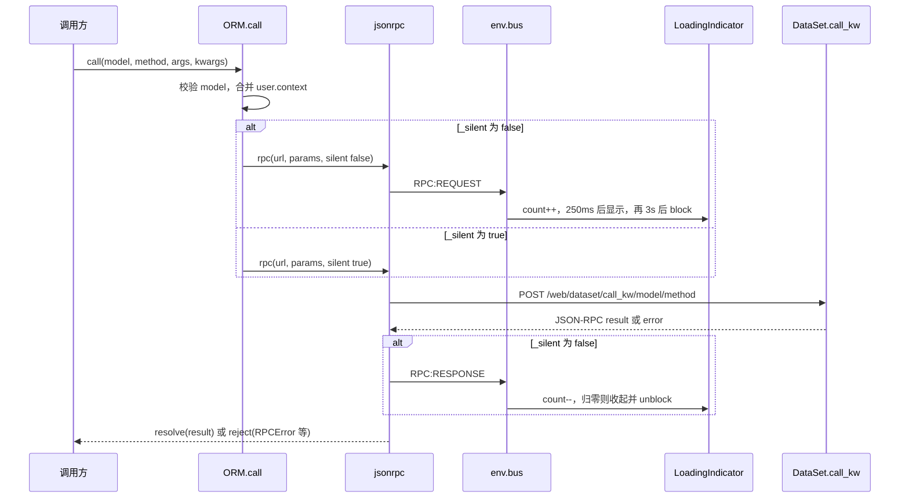

# Odoo 16 orm.call 与 silent.call

`env.services.orm` 是前端调用 Python 模型方法的标准入口。`call` 与 `silent.call` 走同一条 RPC，请求体、路由、权限检查都相同。`silent` 只让这次请求不计入界面上的加载指示器和全屏遮罩。

## 总览

服务定义在 `addons/web/static/src/core/orm_service.js`，启动时依赖 `rpc` 和 `user`，向服务注册表登记名为 `orm` 的服务。组件里通过 `useService("orm")` 取到的是带组件生命周期保护的代理；`env.services.orm` 是原始 `ORM` 实例。测试断言二者不是同一个对象。

一次调用的数据流：

1. 前端校验模型名，把当前用户 context 和调用方 context 合并。
2. `rpc` 以 JSON-RPC 2.0 `POST` 到 `/web/dataset/call_kw/<model>/<method>`。
3. 控制器 `DataSet.call_kw` 拒绝私有方法名，再交给 `odoo.api.call_kw` 执行模型方法，并在返回前 `flush_all()`。
4. 非 silent 的请求在发出和结束时向 `env.bus` 发 `RPC:REQUEST` / `RPC:RESPONSE`。`LoadingIndicator` 根据这两件事更新右下角 Loading，并在持续未完成时挡住界面。

`silent` 只影响第 4 步。

## 对象概览

| 对象 | 所在位置 | 职责 | 与 call 的关系 |
| :--- | :--- | :--- | :--- |
| `ORM` | `orm_service.js` | 组装 `call_kw` 参数，提供 `read` / `write` / `searchRead` 等快捷方法 | `call` 是所有快捷方法的出口 |
| `ORM.silent` | 同文件 getter | 派生一个 `_silent === true` 的对象，不改原实例 | `silent.call` 仍执行 `ORM.call` |
| `ormService` | 同文件 | `start(env, { rpc, user })` 返回 `new ORM(rpc, user)` | `async` 列表让 `useService` 包住 `call` 等方法 |
| `rpc` / `jsonrpc` | `core/network/rpc_service.js` | 发 XHR，把 HTTP/JSON 错误转成 `RPCError` 等 | 读取 `settings.silent`，决定是否触发 bus |
| `user` | `core/user_service.js` | 提供 `lang`、`tz`、`uid` 以及会话里的 `user_context` | `call` 每次读取 `user.context` 的副本作为 context 底稿 |
| `LoadingIndicator` | `webclient/loading_indicator/loading_indicator.js` | 统计进行中的 RPC，延时显示 Loading，再延时 `ui.block()` | 只听 `RPC:REQUEST` / `RPC:RESPONSE` |
| `x2ManyCommands` | `orm_service.js` 同文件导出 | 构造 one2many / many2many 命令三元组 `(command, id, values)` | 与 `call` 无调用关系，写入 x2many 时由调用方放进 `args` |

## 关键依赖

| 依赖 | 级别 | 作用 |
| :--- | :--- | :--- |
| `rpc` 服务 | 一级 | `call` 的唯一网络出口。`silent` 的全部可见效果都发生在这里 |
| `user` 服务 | 一级 | 提供每次请求都要带上的用户 context |
| `registry` `services` | 一级 | 把 `ormService` 登记为 `orm`，WebClient 启动时注入 `env.services` |
| `useService` / `SERVICES_METADATA` | 一级 | 组件销毁后，保护过的 `call` 不再把结果交回已销毁组件 |
| `LoadingIndicator` + `ui.block` / `BlockUI` | 一级 | silent 与普通 call 在界面上的差别落在这里 |
| `error` 服务 + `rpcErrorHandler` | 一级 | 未被 `catch` 的 rejection 仍会弹错误框。silent 不经过这条短路 |
| `DataSet.call_kw`、`odoo.api.call_kw`、`check_method_name` | 一级 | 服务端真正执行方法的位置。两条前端路径命中同一段 Python |
| `legacyEnv.session.rpc` | 二级 | 旧代码的 `settings.shadow` 映射为新 `rpc` 的 `silent` |

## call

```98:110:addons/web/static/src/core/orm_service.js
    call(model, method, args = [], kwargs = {}) {
        validateModel(model);
        const url = `/web/dataset/call_kw/${model}/${method}`;
        const fullContext = Object.assign({}, this.user.context, kwargs.context || {});
        const fullKwargs = Object.assign({}, kwargs, { context: fullContext });
        const params = {
            model,
            method,
            args,
            kwargs: fullKwargs,
        };
        return this.rpc(url, params, { silent: this._silent });
    }
```

构造时 `_silent` 为 `false`。因此 `services.orm.call(...)` 传给 `rpc` 的第三个参数是 `{ silent: false }`。

参数约定：

| 参数 | 含义 | 缺省 |
| :--- | :--- | :--- |
| `model` | 技术模型名，必须是非空字符串 | 无。`false`、`""` 会同步抛出 `Invalid model name: ...`，请求不会发出 |
| `method` | Python 方法名 | 无。前端不校验；以 `_` 开头或名为 `init` 的名字由服务端 `AccessError` 拒绝 |
| `args` | 位置参数列表，对应 Python `*args` | `[]` |
| `kwargs` | 关键字参数。其中 `context` 会与用户 context 合并，其余键原样进入 `kwargs` | `{}` |

Context 合并顺序是：空对象，然后 `user.context`，然后调用方的 `kwargs.context`。同名键以调用方为准。`user.context` 的 getter 每次返回新对象，调用方改自己的 context 不会写回会话。

用户 context 至少包含会话里的 `user_context`，以及 `uid`（后端会话用 `session.uid`，前端门户用 `session.user_id`）。测试里一次 `read` 实际带上的是 `lang`、`tz`、`uid`。

`create`、`read`、`write`、`unlink`、`search`、`searchRead`、`searchCount`、`nameGet`、`readGroup`、`webReadGroup`、`webSearchRead` 全部转调 `call`。因此 `orm.silent.read(...)` 与 `orm.silent.call(model, "read", ...)` 在 silent 标志上等价。差别在快捷方法自己的校验和短路：`read` / `nameGet` 在 `ids` 为空时直接 `Promise.resolve([])`，`unlink` 在 `ids` 为空时直接返回 `true`，都不会发 RPC。`call` 没有这层短路，`call(model, "read", [[], fields])` 仍会打到服务器。

## silent

```94:96:addons/web/static/src/core/orm_service.js
    get silent() {
        return Object.assign(Object.create(this), { _silent: true });
    }
```

每次读取 `orm.silent` 都得到一个新对象：

- 原型是当前这次访问的 `this`（原始 `ORM`，或 `useService` 返回的代理）。
- 自有属性只有 `_silent: true`，盖住原型上的 `false`。
- `rpc`、`user`、`call` 等方法沿原型链找到，所以参数组装逻辑与普通 `call` 相同。

原实例的 `_silent` 保持 `false`。下面三行里，中间那次是 silent，前后两次仍会驱动加载指示器。这是 `orm_service_tests.js` 里 “silent mode” 用例锁定的行为。

```javascript
orm.call("my_model", "my_method");
orm.silent.call("my_model", "my_method");
orm.call("my_model", "my_method");
```

`rpc` 里 `settings.silent` 为真时，跳过全部 `env.bus.trigger("RPC:REQUEST" | "RPC:RESPONSE", id)`。覆盖发送前、HTTP 502、响应不是 JSON、正常返回、XHR `error`、以及 `promise.abort()`。响应解析和 `reject` 不看这个标志：业务异常仍是 `RPCError`，502 或无法解析的响应对应 `ConnectionLostError`，主动 `abort(true)` 对应 `ConnectionAbortedError`。

`LoadingIndicator` 只订阅这两个 bus 事件：

- 从 0 个进行中的请求变成 1 个时，250ms 后若仍有请求，右下角显示 Loading，并再排一个 3000ms 的定时器。
- 定时器到期则 `uiService.block()`，`BlockUI` 铺上全屏半透明遮罩和 “Loading...” 文案。
- 进行中的 id 集合清空后，关掉角标，并在曾经 block 过的情况下 `unblock()`。

silent 请求不进入这个集合，所以它既不会让角标亮起，也不会单独把界面挡住。同一时刻若还有普通 RPC 在跑，那些请求仍照常计数、照常可能挡住界面。

源码注释里预留过 `orm.withOption({ shadow: true })` 这种“顺便不显示错误”的 API，当前文件没有实现。已经落地的开关就是 `_silent`。旧前端 `session.rpc(..., { shadow: true })` 在 `legacy/utils.js` 里被映射成 `services.rpc(route, params, { silent: settings.shadow })`，名字从 shadow 换成了 silent，语义仍是“不要计入加载反馈”。

## 错误仍然会冒出来

`error` 服务监听 `unhandledrejection`。`RPCError` 交给 `rpcErrorHandler`：按异常名找 notification 或 dialog 注册项，找不到就打开 `RPCErrorDialog`。`ConnectionLostError` 由 `lostConnectionHandler` 弹出 “Connection lost. Trying to reconnect...”。

这两条路径读取的是 rejection，不读取 `settings.silent`。调用方 `await` 之后没有 `catch`、或 `catch` 里又抛出去，对话框仍会出现。需要把一次失败当成正常分支时，要自己 `try/catch`。Domain 字段就是这样做的。

组件通过 `useService("orm")` 使用时，`env.js` 把服务声明的 `async` 方法名记入 `SERVICES_METADATA`，`useService` 再用 `_protectMethod` 包一层：

- 组件已经 `destroyed` 时，调用直接 `reject(new Error("Component is destroyed"))`，RPC 不会发。
- 请求返回时组件已销毁，包装后的 Promise 永不 settle，避免对已销毁组件 `setState`。底层 XHR 仍会结束。
- 包装对象转发 `abort`。

`silent` 不在 `async` 列表里。它是 getter，`useService` 的代理通过原型链继承它。`this.orm.silent.call(...)` 里，`call` 仍是包过的那个函数，`this` 是 `_silent: true` 的派生对象，所以生命周期保护对 `silent.call` 同样有效。

## 调用链



服务端 `DataSet._call_kw`：

1. `check_method_name`：方法名匹配 `^(_.*|init)$` 时抛 `AccessError`。
2. `api.call_kw` 按方法的 `_api` 分发。`@api.model` 走 `_call_kw_model`；`create` 走 `_call_kw_model_create`（单字典创建时把 recordset 降成 id）；其余走 `_call_kw_multi`，把 `args[0]` 当作要 `browse` 的 ids。
3. 执行前用 `split_context` 取出 context，`with_context` 后再调用。
4. 返回前 `model.env.flush_all()`，把本请求里尚未写出的脏缓存落库。

URL 里的 `<model>/<method>` 只是路径装饰。控制器签名是 `call_kw(self, model, method, args, kwargs, path=None)`，真正用的是 JSON 体里的 `model`、`method`、`args`、`kwargs`。

## 实际场景

### 表单字段 onchange

用户改了带 onchange 的字段后，`Record._onChange` 调用：

```1273:1283:addons/web/static/src/views/relational_model.js
        const { domain, value: changes, warning } = await this.model.orm.call(
            this.resModel,
            "onchange",
            [
                this.resId ? [this.resId] : [],
                this.getChanges(true, true),
                fieldNames && fieldNames.length ? fieldNames : [],
                this._getOnchangeSpec(),
            ],
            { context: this.context }
        );
```

这是用户正在等待的写路径：返回的 `value` 要写回表单，`warning` 要变成对话框或通知。请求可能要跑业务计算，超过 250ms 就应该看到 Loading；超过大约 3.25s 就应该挡住界面，避免用户在 onchange 尚未写回时继续改同一条记录。Python 侧 `UserError` 也必须变成 `RPCError` 对话框，否则用户不知道保存链路为什么停了。这里用普通 `call`。

### 关系字段按名字搜索

`Many2XAutocomplete` 在用户输入时调用 `name_search`（`views/fields/relational_utils.js`）。Many2one 的条码扫描同样是 `this.orm.call(this.relation, "name_search", [], { name, args: domain, operator, limit, context })`。搜索结果要填进下拉或直接写入字段，权限错误、模型不存在都应让用户看见。这也是普通 `call`。

用户菜单 “My Profile” 使用 `orm.call("res.users", "action_get")`，调试菜单切换 `noupdate`、读取 `get_metadata` 也是 `orm.call`。共同点是：这次 RPC 就是用户点下去的那个动作，加载反馈和错误对话框都应该出现。

### Domain 字段的记录数

`DomainField.loadCount` 在字段初次渲染和 props 更新时，用当前 domain 调目标模型的 `search_count`，把数字显示在字段上。domain 在用户编辑过程中经常是半截字符串，服务端会因为非法 domain 抛错。

```117:128:addons/web/static/src/views/fields/domain/domain_field.js
        try {
            const domain = this.getDomain(props.value).toList(this.getContext(props));
            recordCount = await this.orm.silent.call(
                this.getResModel(props),
                "search_count",
                [domain],
                { context: this.getContext(props) }
            );
        } catch (_e) {
            Object.assign(this.state, { recordCount: 0, isValid: false });
            return;
        }
```

这里用 `silent.call` 加 `try/catch`，两件事分工不同：

- `silent` 让这次辅助计数不点亮 Loading、不挡住正在编辑的表单。domain 每次变更都会打一次 `search_count`，若走普通 `call`，快速编辑时右下角会反复闪 Loading，慢查询时还可能整页被遮罩挡住。
- `catch` 把失败收成 `recordCount: 0`、`isValid: false`。少了这层 catch，silent 挡不住错误对话框。

关闭 “选中记录” 弹窗时也会再跑 `loadCount`，因为弹窗里可能改过影响计数的数据。那次同样是辅助刷新，继续走 silent。

### 看板列的 tooltip

看板按 many2one 分组且配置了 tooltip 字段时，`KanbanGroup.loadTooltip` 使用 `this.model.orm.silent.read(resModel, [this.value], ["display_name", ...fieldNames])`。列头已经画出来了，tooltip 是悬停才用的附加信息，和看板主数据加载不是同一次用户等待。`silent.read` 内部仍是 `call(..., { silent: true })`。多个列的 read 还会被 `KeepLast` 接住：只有最后一次的结果写回 `this.tooltip` 并 `notify()`。最后一次若失败，rejection 仍会抛出，silent 不会把它吃掉。

## 二次开发时容易踩的点

- 想“后台悄悄调用、失败也别弹窗”时，只写 `silent.call` 不够。silent 管的是加载指示器；弹窗来自未捕获的 rejection。预期内的失败要 `try/catch`，并决定是改本地状态、发 notification，还是继续抛出。
- 不要给共享的 `env.services.orm` 写 `_silent = true`。那样会把后续所有调用都变成 silent，直到有人改回去。公开写法是每次 `orm.silent.call(...)`，派生对象用完即弃。
- `call` 不做空 id 短路。能用 `read` / `unlink` / `nameGet` 表达的批量读取或删除，优先用快捷方法，空列表就不会产生一次无意义的 `call_kw`。
- 模型名在发请求前同步校验。`model` 来自另一个字段、当前还是 `false` 时，`call` 抛 `Invalid model name: false`。这不是 RPC 错误，silent 也改变不了它。
- 方法名不要以 `_` 开头。`check_method_name` 对普通 `call` 和 `silent.call` 一视同仁。
- 业务 context（例如 `active_id`、`allowed_company_ids`）放在 `kwargs.context`。它覆盖同名的用户 context 键，用户的 `lang` / `tz` / `uid` 仍会留下。
- 在 OWL 组件里用 `useService("orm")`，不要长期保存 `env.services.orm` 再在销毁后继续 `setState`。保护层只包在 `useService` 返回值上。
- `silent` 不表示请求可有可无、也不表示可以不带权限。它仍是一次 `auth="user"` 的 `call_kw`，访问规则、记录规则和 `flush_all` 都照常执行。

## call 与 silent.call 的区别

| 维度 | `services.orm.call` | `services.orm.silent.call` |
| :--- | :--- | :--- |
| 代码路径 | `ORM.call`，`_silent` 为 `false` | getter 造出 `_silent` 为 `true` 的新对象，再进入同一个 `call` |
| 是否改全局 ORM | 否 | 否。原实例保持 `_silent === false`，下一次普通 `call` 仍会计入加载 |
| URL | `/web/dataset/call_kw/<model>/<method>` | 相同 |
| JSON 体 | `model`、`method`、`args`、合并后的 `kwargs.context` | 相同 |
| 用户 context | `user.context` 打底，调用方 context 覆盖同名键 | 相同 |
| 服务端 | `check_method_name` → `api.call_kw` → `flush_all` | 相同 |
| `env.bus` | 发送 `RPC:REQUEST`，结束或 abort 时发送 `RPC:RESPONSE` | 这两次事件都不发 |
| 右下角 Loading | 计入并发；持续超过 250ms 则显示 | 不计入 |
| 全屏 BlockUI | 该请求若一直挂着，自首次计入起约 3.25s 后 `ui.block()` | 不会因为这次请求去 block |
| 成功返回值 | JSON-RPC 的 `result` | 相同 |
| 失败 | `reject` `RPCError`、`ConnectionLostError` 或 `ConnectionAbortedError` | 相同 |
| 未捕获时的错误框 | `error` 服务会打开 | 同样会打开 |
| 适合的调用 | 用户正在等结果的动作：onchange、`name_search`、按钮触发的模型方法、打开一个 action | 界面已经可用、失败可由调用方收掉的辅助请求：Domain 记录数、看板 tooltip |

选用时看这次 RPC 是不是用户当前动作的主路径。主路径用 `call`，让加载反馈和错误对话框跟着走。旁路刷新用 `silent.call`，并在调用点处理预期中的失败。

## 参考阅读

- `addons/web/static/src/core/orm_service.js`：`ORM.call`、`silent` getter、各快捷方法。
- `addons/web/static/tests/core/orm_service_tests.js`：context 合并与 silent 不影响后续调用的回归测试。
- `addons/web/static/src/core/network/rpc_service.js`：`jsonrpc` 在哪些分支读取 `settings.silent`。
- `addons/web/static/src/webclient/loading_indicator/loading_indicator.js`：250ms 与 3000ms 两级反馈。
- `addons/web/static/src/core/errors/error_handlers.js`：`RPCError` 与断线通知。
- `addons/web/static/src/core/utils/hooks.js`：`useService` 对 `async` 方法的销毁保护。
- `addons/web/controllers/dataset.py`、`odoo/api.py` 的 `call_kw`、`odoo/models.py` 的 `check_method_name`。
- 调用样本：`views/relational_model.js` 的 `_onChange`，`views/fields/domain/domain_field.js` 的 `loadCount`，`views/kanban/kanban_model.js` 的 `loadTooltip`。
